# SENDER GLEIWITZ — 31.08.1939

**Skradankowa gra FPP o prowokacji gliwickiej. Nie zmienisz historii. Możesz ocalić prawdę.**

Zespół **Kosynierzy** · Hackaton 2026 · Unity 6.6 (URP)

[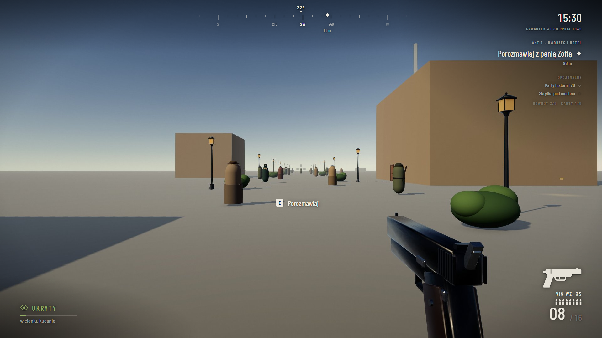](docs/trailer/Sender-Gleiwitz-trailer.mp4)

▶ **Trailer:** [`docs/trailer/Sender-Gleiwitz-trailer.mp4`](docs/trailer/Sender-Gleiwitz-trailer.mp4) (80 s, 1080p)

---

## O grze

31 sierpnia 1939, Gliwice (wtedy Gleiwitz, Niemcy). Esesmani z SD pod dowództwem Alfreda Naujocksa, przebrani za polskich powstańców, napadną wieczorem na radiostację i nadadzą po polsku krótki komunikat. Na miejscu zostawią ciało Franciszka Honioka jako „dowód polskiego ataku”. Następnego dnia Hitler powie: „od 5:45 odpowiadamy ogniem”.

Grasz jako **Jan Wrona, kryptonim „Kruk”**, agent polskiego wywiadu (Ekspozytura nr 4, Katowice). Wojny nie zatrzymasz. Możesz za to zdobyć dowody, że cała akcja była kłamstwem, i przewieźć je do Katowic przed północą.

> Prowokacja opierała się na kłamstwie. Jedyną bronią przeciwko kłamstwu są dowody.

### Misja „Babcia umarła” w 4 aktach
| Akt | Godzina | Co robisz |
|---|---|---|
| 1. Dworzec i hotel | 15:30 | Pani Zofia z księgarni daje ci aparat. Zakradasz się do pokoju Naujocksa w Haus Oberschlesien, fotografujesz mapę i podsłuchujesz hasło „Großmutter gestorben”. |
| 2. Przez miasto | 16:00–19:45 | Śledzisz auto SD przez Gliwice. Misje poboczne: fotograf i gestapowiec, kolejarz, skrytka pod mostem, 6 Kart historii. Zapada zmrok. |
| 3. Radiostacja | 20:00 | Wchodzisz przez dziurę w płocie albo przez bramę. SD podłącza mikrofon burzowy, a ty masz **90 sekund** na przecięcie linii wzmacniacza. Możesz uwolnić pracowników z piwnicy. |
| 4. Konserwa i ucieczka | 20:10 | Ostatnie zdjęcie przy ciele Honioka. Alarm w mieście, pościg na wschód i przekazanie filmu kurierowi. |
| Epilog | — | Fakty historyczne. *„Prowokacja trwała kilka minut. Wojna trwała sześć lat.”* |

### Najważniejsze mechaniki
- **Kamera FPP:** chód, skradanie, sprint z wytrzymałością, wślizg i skok.
- **Skradanie jak w Hitmanie:** wskaźnik wykrycia, kryjówki, ciche obezwładnienie od tyłu bagnetem, znalezione ciała i panika cywilów.
- **Jedno trafienie = koniec.** Strzał do cywila też kończy misję („Polski agent nie strzela do cywilów”).
- **Aparat Leica:** każde zdjęcie to dowód w sprawie.
- **Broń z epoki:** Vis wz. 35 i bagnet od startu, karabin w zbrojowni w akcie 3. Wybór wyposażenia jak w CS2.
- **Pora dnia sterowana misją:** od 19:00 zapada noc, w mieście włączają się latarnie.
- **Mapa Gliwic 1939** zbudowana na danych OSM: Rynek z ratuszem, dworzec, hotel, kościół, radiostacja z drewnianą wieżą (111 m) i wnętrza.
- **21 postaci z animacjami**, dialogi PL/DE z napisami, muzyka i dźwięki otoczenia.
- **Punkt kontrolny na każdym kroku misji.** Tryb Historyczny gra się bez punktów kontrolnych.
- **Opcja „Krew (16+)”:** domyślnie gra jest bez krwi.

## Sterowanie
| Klawisz | Akcja |
|---|---|
| W A S D / strzałki | Ruch |
| Shift | Sprint |
| C / Ctrl | Kucanie / skradanie |
| Spacja | Skok |
| PPM | Celowanie |
| LPM | Strzał / cios (strzał tylko podczas celowania) |
| R | Przeładowanie |
| E | Interakcja, dalej w dialogu, zamknięcie karty |
| F | Aparat (podnieś / zrób zdjęcie) |
| 1 / 2 / 3 / 4 | Pistolet / karabin / bagnet / aparat |
| Kółko myszy | Zmiana przedmiotu |
| Tab / Q, Enter | Wybór wyposażenia, zatwierdzenie |
| Esc | Pauza i ustawienia |
| F1 / F8 / F9 | (dev) Pomiń krok / zapisz / wczytaj |

Gamepad też działa (lewa gałka, A skok, B kucanie, RT cios).

## Jak uruchomić
1. Zainstaluj **Unity 6000.6.5f1** (Unity 6.6) przez Unity Hub.
2. `git clone https://github.com/MikolajczykProjects/Kosynierzy.git` i otwórz folder w Hub.
3. Przy pierwszym uruchomieniu kliknij w menu:
   - **Tools → Zbuduj Gliwice**, żeby zbudować mapę,
   - **Postacie → Zbuduj wszystko**, żeby zbudować postacie i ręce FPP,
   - **Kosynierzy → Refresh Prefab Registry**.
4. Otwórz `Assets/Scenes/SampleScene.unity` i wciśnij **Play**.

Szczegóły mapy: `Assets/_Mapa/CZYTAJ_NAJPIERW_AI.md`. Szczegóły postaci: `Assets/_Postacie/CZYTAJ.txt`.

## Demo z gry (nagrane w Unity)
| | |
|---|---|
| 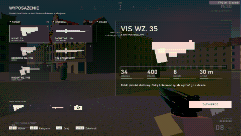 **Wyposażenie** — wybór pistoletu i broni białej | 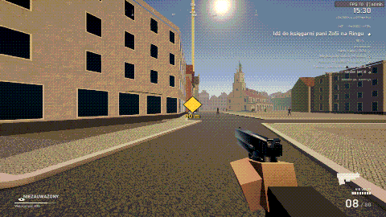 **Gliwice 1939** — znacznik celu, HUD, ulice |
| 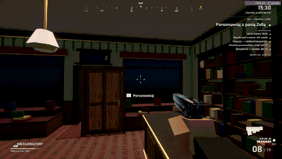 **Księgarnia pani Zofii** — wnętrze, rozmowa | 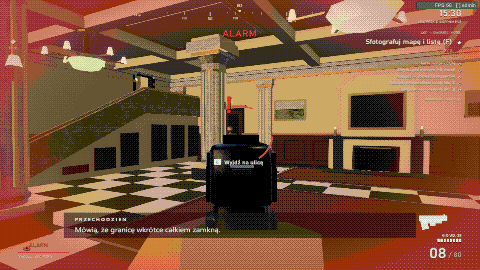 **Hotel** — dowody, wykrycie i alarm |
| 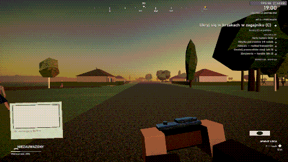 **Zmrok** — zagajnik, aparat, kryjówka | 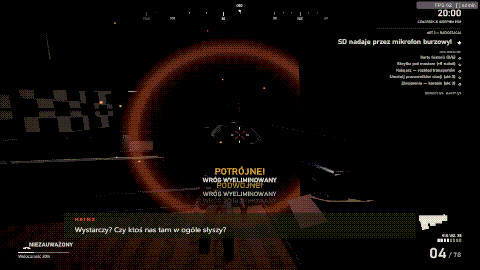 **Radiostacja** — SD nadaje komunikat |
| 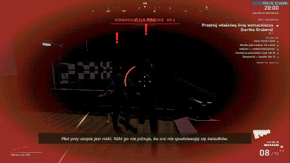 **Alarm** — SD wykrywa gracza i otwiera ogień | |

GIF-y nagrywa `Assets/Scripts/Core/DemoRecorder.cs` (Play), składa `node tools/gif/make_gif.js <folder> <out.gif>`.

## Zrzuty z gry
| | |
|---|---|
|  | 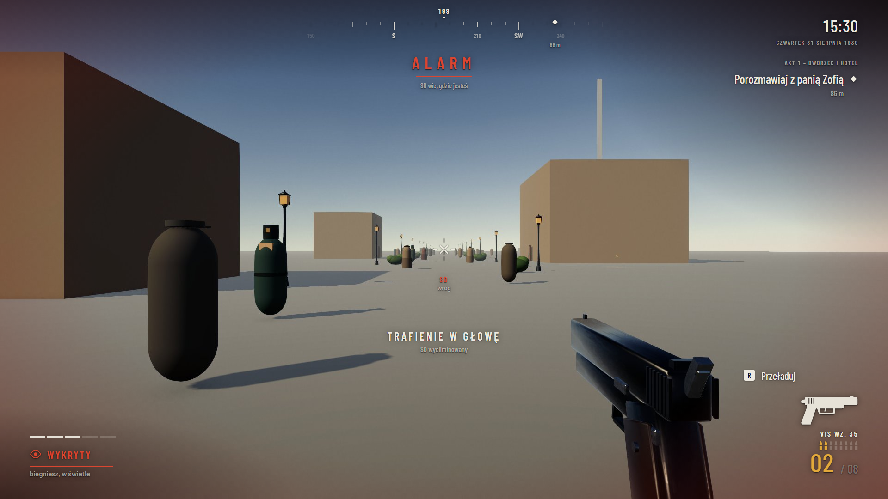 |
| 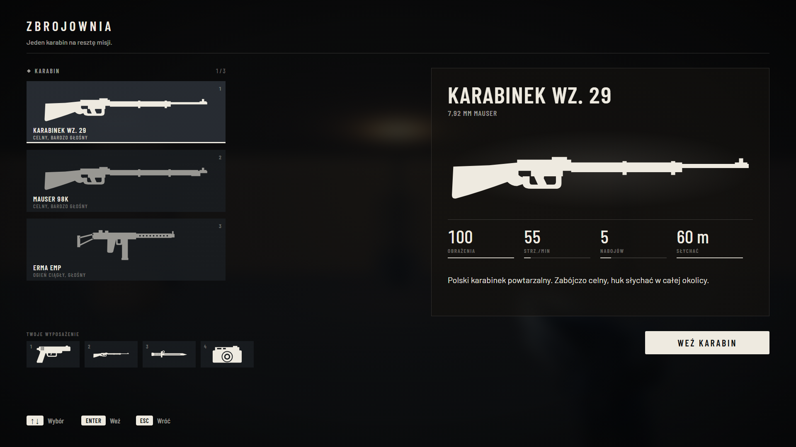 | 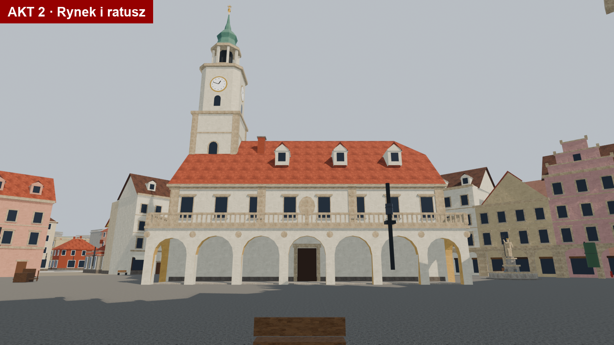 |

## Struktura repo
| Folder | Zawartość |
|---|---|
| `Assets/Scripts/` | Kod gry: `Player`, `Weapons`, `Combat`, `AI` (NPC, SD, Schupo, cywile), `Stealth`, `Mission`, `Quests`, `Dialogue`, `Interaction` (aparat, drzwi), `Audio`, `VFX`, `UI`, `Admin`, `Core` |
| `Assets/_Mapa/` | Mapa Gliwic 1939: modele, tekstury, skrypt „Zbuduj Gliwice”, podglądy aktów |
| `Assets/_Postacie/` | 21 postaci (Humanoid, 13 animacji) i ręce FPP z 7 brońmi |
| `Assets/_Obiekty/` | Broń, rekwizyty, efekty (np. błysk lufy) |
| `Assets/_Dialogi/` | Dialogi PL/DE, nagrania, muzyka, dźwięki otoczenia, manifesty |
| `Assets/_Gra/` | Sceny gry |
| `SourceArt/`, `Zrodla-mapy/` | Źródła z Blendera i dane OSM. Nie są importowane do Unity. |
| `docs/` | Dokumentacja projektu, opisana niżej |
| `tools/` | Narzędzia pomocnicze (podgląd UI, most do Figmy) |

## Dokumentacja
| Plik | Co zawiera |
|---|---|
| [`docs/OPIS.md`](docs/OPIS.md) | Opis projektu na prezentację: pitch, historia, zespół, technologia |
| [`docs/FABULA.md`](docs/FABULA.md) | Pełna fabuła i tło historyczne |
| [`docs/DECISIONS.md`](docs/DECISIONS.md) | Decyzje projektowe i techniczne |
| [`docs/NOTES.md`](docs/NOTES.md) | Notatki techniczne |
| [`docs/00-PODZIAL-I-ZASADY.txt`](docs/00-PODZIAL-I-ZASADY.txt) | Podział ról w zespole i zasady |
| `docs/ROLA-A…D-*.txt` | Zadania ról: mapa i dialogi, Unity, postacie, obiekty |
| [`docs/design/UI_V2_SPEC.md`](docs/design/UI_V2_SPEC.md) | Specyfikacja interfejsu v2 |
| [`docs/research/`](docs/research/) | Research UI strzelanek wojennych |
| [`CLAUDE.md`](CLAUDE.md) | Instrukcja dla AI: co gdzie leży i czego nie ruszać |

## Historia, nie fikcja
Napad na radiostację, Naujocks, hasło „Großmutter gestorben”, mikrofon burzowy i Franciszek Honiok to fakty. Akcja była częścią Operacji Himmler, a prawdę ujawnił sam Naujocks w zeznaniu dla Trybunału w Norymberdze (20.11.1945). Fikcyjni są „Kruk”, pani Zofia, Heinz, Paul Gruber i kurier „Sowa”.

Radiostacja stoi do dziś: **Muzeum w Gliwicach, ul. Tarnogórska 129**.

Gra nie pokazuje symboli nazistowskich (art. 256 kk). Honiok jest pokazany z szacunkiem.
